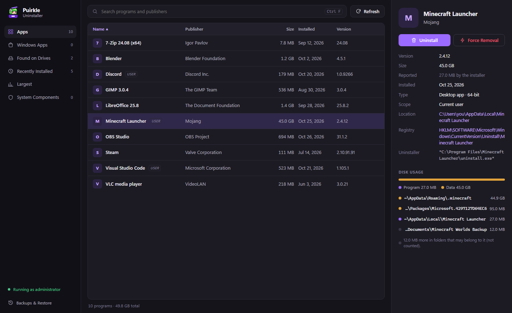
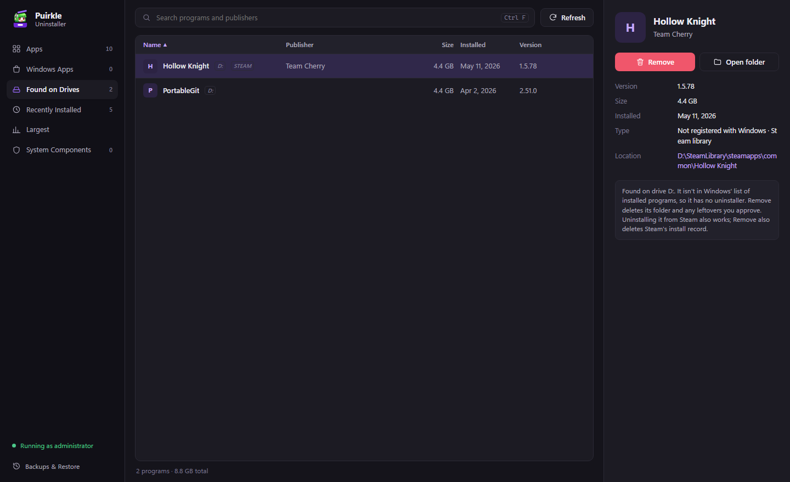
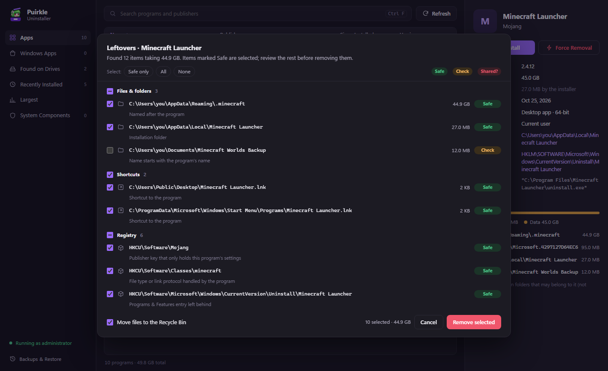
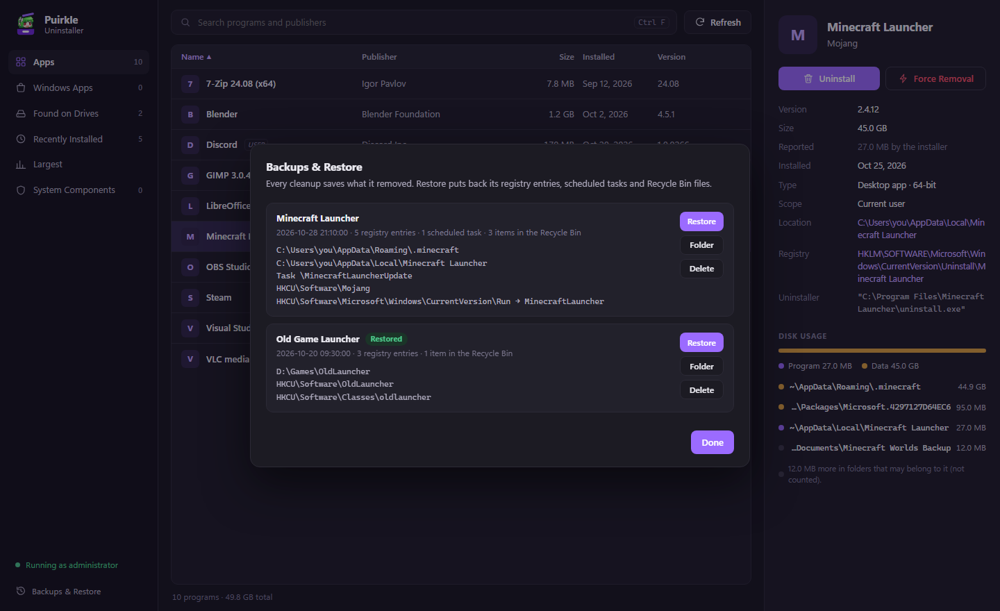

<p align="center">
  <picture>
    <source media="(prefers-color-scheme: dark)" srcset="docs/logo-dark.png">
    
  </picture>
</p>

<p align="center">
  <b>Uninstall Windows programs completely, including everything they leave behind.</b><br>
  Free and open source. Windows 10 and 11.
</p>

<p align="center">
  <a href="https://github.com/Puirkle/PuirkleUninstaller/releases/latest"></a>
  <a href="https://github.com/Puirkle/PuirkleUninstaller/actions/workflows/ci.yml"></a>
  <a href="LICENSE"></a>
  <a href="https://buymeacoffee.com/puirkle"></a>
</p>



Most programs leave things behind when you uninstall them: settings folders, caches, game saves,
registry keys, startup entries, services, scheduled tasks. PuirkleUninstaller runs the program's own
uninstaller, then finds those leftovers and lets you remove them. If the uninstaller is broken or
missing, it can remove the program without it.

## Download

Get the latest version from **[Releases](https://github.com/Puirkle/PuirkleUninstaller/releases/latest)**:

- **`PuirkleUninstaller_x.y.z_x64-setup.exe`**: the installer (recommended)
- **`PuirkleUninstaller_x.y.z_x64_en-US.msi`**: an MSI package, for managed installs

The installer isn't code-signed yet, so Windows SmartScreen may show a warning. Click
**More info → Run anyway**.

## Features

### See every program, and how much space it really uses
- Lists desktop programs (64-bit, 32-bit and per-user) and Microsoft Store apps, with icons,
  publishers, versions and install dates.
- **Real size**: counts the program's folder *plus* the data it creates later, such as saves,
  caches, mods and downloaded content. A game launcher that its installer says is 27 MB but keeps
  45 GB of worlds shows 45 GB, and the details panel breaks that down folder by folder.
- Views for **Recently installed**, **Largest** and **System components**, plus instant search.

### Find programs Windows doesn't know about


**Found on Drives** scans every drive for software that never shows up in Windows' list of
installed programs: portable apps, copied or unpacked games, Steam library games, and programs
whose uninstall entry has gone missing. You can see how big they are and remove them.
Code projects and build folders are skipped.

### Uninstall, then clean up what's left


After the uninstaller finishes, PuirkleUninstaller looks for leftovers in:

- **Files and folders**: Program Files, AppData (Roaming, Local, LocalLow), ProgramData,
  Documents, Saved Games, every drive, and publisher folders
- **Shortcuts**: Start Menu, Desktop and taskbar, matched by where they point, not only by name
- **Registry**: settings keys, the uninstall entry, Windows Installer records, App Paths, startup
  entries, file types and link protocols, "Open with", right-click menu entries and shell
  extensions, firewall rules and usage traces
- **Services and scheduled tasks** that run from the program's folder
- **Steam's install record** when you remove a Steam game

You review everything before anything is deleted. Each item says why it was found and how sure
the app is:

| Badge | Meaning | Selected by default |
|---|---|---|
| **Safe** | Points into the program's folder, or is clearly named after it | Yes |
| **Check** | Probably belongs to it, but have a look first | No |
| **Shared?** | Another installed program might use it too | No |

### Force Removal
For programs whose uninstaller is missing, broken or refuses to run. PuirkleUninstaller closes
the program, stops its services, and removes its files and registry entries directly, again after
you review them.

### Undo any cleanup


Every cleanup is backed up. **Backups & Restore** can put back registry keys and values with their
exact data, re-create scheduled tasks, and move files back out of the Recycle Bin. You can undo
right after a cleanup, or later from the sidebar.

### Built to be safe
- Never touches Windows, your user folders, drive roots or another program's folder.
- Files go to the **Recycle Bin** by default.
- Files that are in use are deleted when Windows restarts, instead of failing.
- Runs as administrator so it can clean system locations. Say No to the prompt to use it in
  limited mode.

### Keyboard shortcuts
| Keys | Action |
|---|---|
| `Ctrl` + `F` | Search |
| `↑` `↓` | Move through the list |
| `Enter` / `Delete` | Uninstall |
| `Shift` + `Delete` | Force Removal |
| `F5` | Refresh |

## Support the project

PuirkleUninstaller is free. If it saved you some disk space or a headache, you can support it:

- ☕ **[Buy Me a Coffee: buymeacoffee.com/puirkle](https://buymeacoffee.com/puirkle)**
- 🇹🇭 **Thai supporters: [ezdn.app/puirkle](https://ezdn.app/puirkle)**

## Build from source

Requirements:
- Windows 10/11
- [Rust](https://rustup.rs) (stable, MSVC toolchain), with Visual Studio Build Tools and the
  "Desktop development with C++" workload
- [Node.js](https://nodejs.org) 18 or newer

```bash
npm install
npm run dev      # run in development mode
npm run build    # build the app and installers into src-tauri/target/release/bundle
```

Run the tests with `cargo test --manifest-path src-tauri/Cargo.toml`. These read-only checks
print what the app would find on your PC without deleting anything:

```bash
cargo test --manifest-path src-tauri/Cargo.toml dry_run -- --ignored --nocapture
cargo test --manifest-path src-tauri/Cargo.toml discover_dry_run -- --ignored --nocapture
```

| Path | What it does |
|---|---|
| `ui/` | Interface (plain HTML, CSS and JavaScript, no build step) |
| `src-tauri/src/programs.rs` | Lists installed programs and Store apps |
| `src-tauri/src/discover.rs` | Finds unregistered programs on every drive |
| `src-tauri/src/uninstall.rs` | Runs uninstallers and prepares Force Removal |
| `src-tauri/src/leftovers.rs` | Leftover detection, disk usage and safety rules |
| `src-tauri/src/cleanup.rs` | Deletion, backups, deletion at restart |
| `src-tauri/src/rollback.rs` | Backups & Restore |

Built with [Tauri 2](https://tauri.app) and Rust.

## License

[MIT](LICENSE) © 2026 Puirkle
